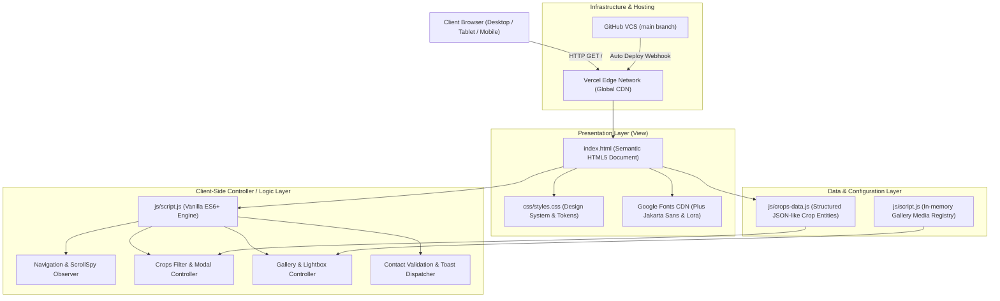
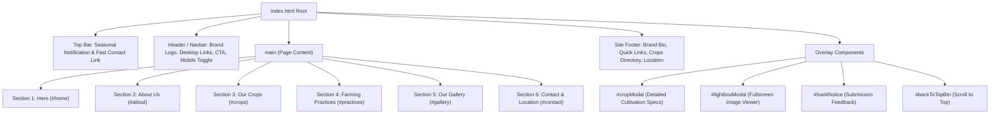
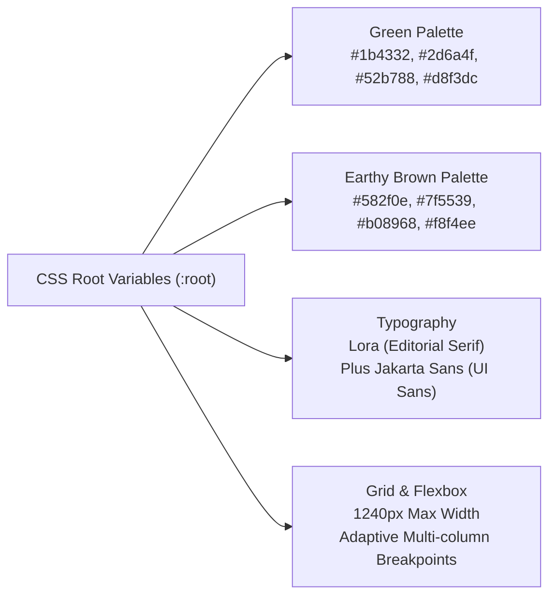
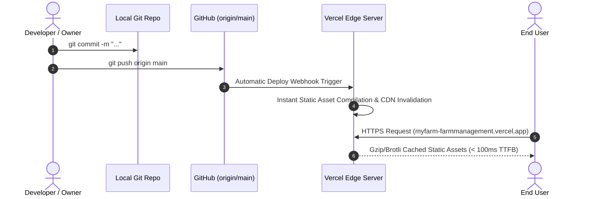

# Website Architecture: MyFarm – Growing with Nature 🌾

This document details the architectural design, system decomposition, data flow, and front-end engineering principles behind **MyFarm – Growing with Nature**.

---

## 1. High-Level Architectural Diagram

---

## 2. Architectural Principles & Patterns

The architecture follows **JAMstack (JavaScript, APIs, Markup)** with a **Model-View-Controller (MVC)** separation on the client side:

| Layer | Corresponding Component | Responsibility |
| :--- | :--- | :--- |
| **Model (Data)** | `js/crops-data.js` | Stores structured domain data (crop names, botanical tags, seasons, soil requirements, water cycles, descriptions, and media links). Decoupled from HTML representation so non-technical farm owners can update crops without touching markups. |
| **View (Presentation)** | `index.html`, `css/styles.css` | Semantic HTML5 structure with ARIA landmark roles, responsive layout grids, and design tokens for color, typography, elevation, and responsiveness. |
| **Controller (Logic)** | `js/script.js` | Event handling, state management (modal open/closed, current active filter, lightbox index), dynamic DOM rendering, and user input validation. |

---

## 3. Component & DOM Hierarchy

---

## 4. Subsystem Breakdown

### 4.1. Navigation & ScrollSpy Engine
* **Observer:** Continuously observes window scroll position relative to section bounding boxes (`#home`, `#about`, `#crops`, `#practices`, `#gallery`, `#contact`).
* **Active State:** Dynamically updates `.nav-link.active` with bottom bar indicators.
* **Frosted Glass Blur:** Appends `.scrolled` state to navbar after passing `scrollY > 30px`.
* **Mobile Drawer:** Accessible drawer triggered via `aria-expanded` toggle with outside-click and route-click auto-close listeners.

### 4.2. Crops Data & Rendering Engine
* **Source of Truth:** Array of objects in `cropsData`.
* **Filtering:** Instant DOM re-render without page refresh based on the selected category (`all`, `cereals`, `pulses`).
* **Detail Modal:** Intercepts `data-open-crop` button events, matches crop entity by `id`, populates metadata specs into modal markup, and locks background scroll (`body.style.overflow = 'hidden'`).

### 4.3. Interactive Gallery & Lightbox Controller
* **Data Set:** Curated photography registry categorizing shots into `fields`, `crops`, `farm-life`, and `harvest`.
* **Lightbox State Machine:**
  * Tracks `currentLightboxIndex`.
  * Responds to keyboard shortcuts: `Escape` (dismiss), `ArrowRight` (next), `ArrowLeft` (previous).
  * Smooth cyclic navigation (`(index + 1) % length`).

### 4.4. Contact & Validation Subsystem
* **Client-Side Validation:** Validates full name length ($\ge 2$ characters), email structure (standard RFC-compliant regex), and message body ($\ge 10$ characters).
* **Feedback Pipeline:** Shows an animated loading spinner on the submit button, clears form inputs, and dispatches a persistent 5-second animated toast notification.

---

## 5. Design System & CSS Token Architecture

### Responsive Breakpoint Strategy
* **Desktop ($> 1024\text{px}$):** Multi-column grids (3-column crop cards, 3-column gallery, 2-column contact split).
* **Tablet ($769\text{px} - 1024\text{px}$):** 2-column grids with adjusted hero padding and stacked practice cards.
* **Mobile ($\le 768\text{px}$):** Single-column layout, off-canvas sliding mobile menu, stacked forms and footers.

---

## 6. Hosting & CI/CD Pipeline

